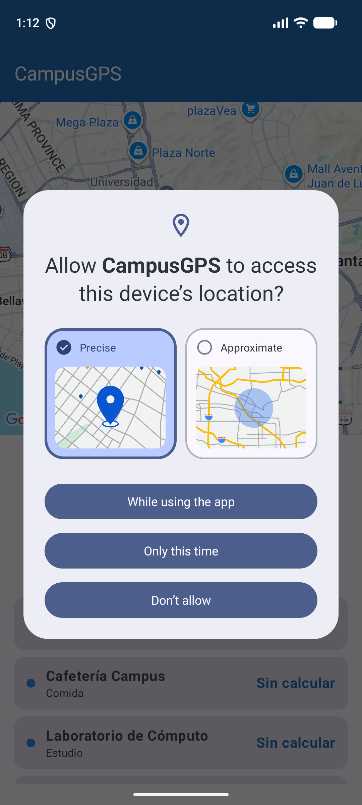
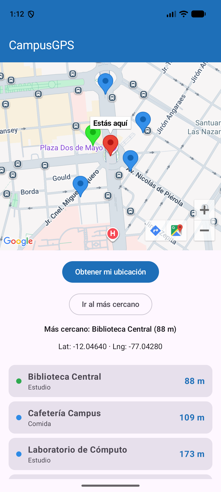
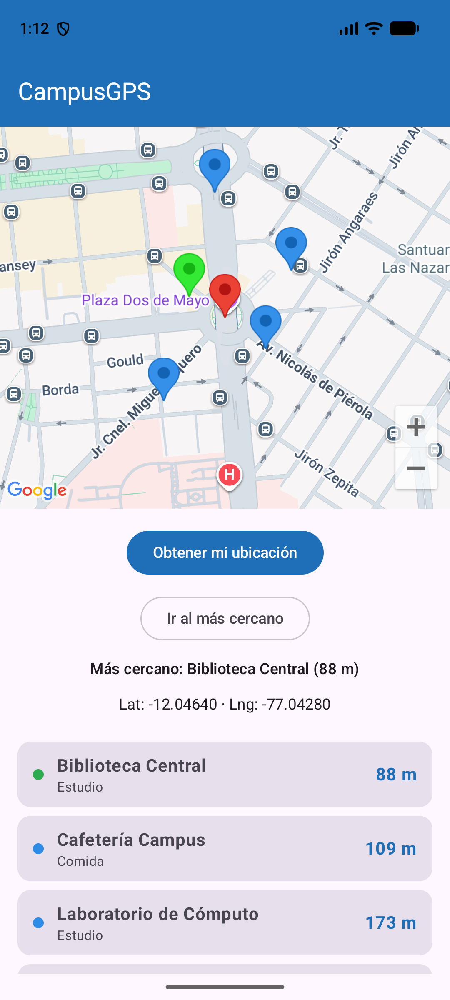
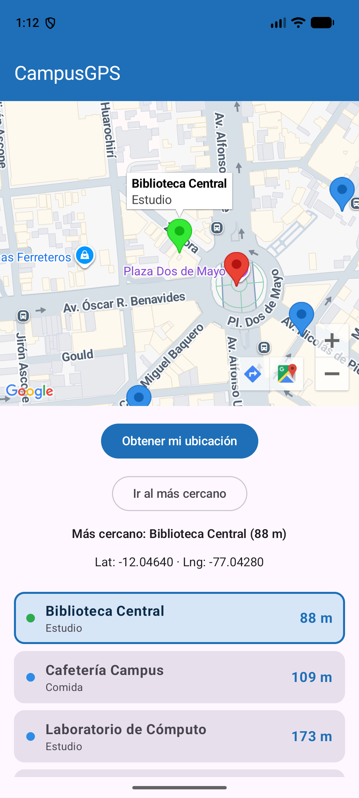
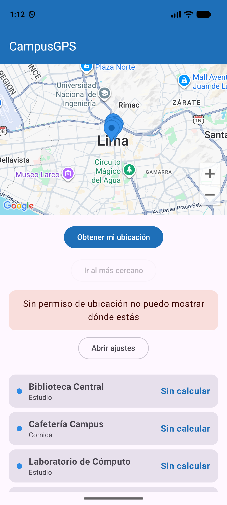
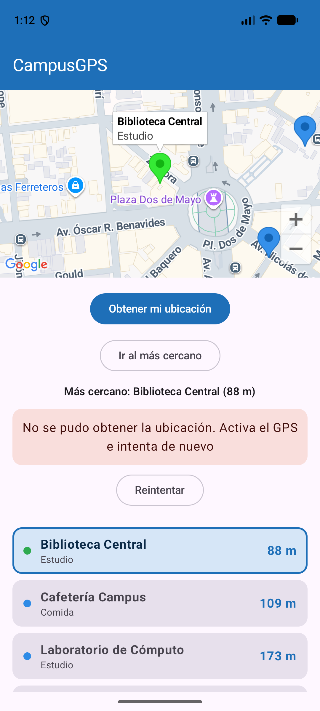

# CampusGPS

**Laboratorio 13 · Localización Geográfica** · Programación en Móviles · Tecsup
**Alumno:** Lucas Inga Marín · **Docente:** Juan León S.

App Android que obtiene la ubicación del celular, la muestra en un mapa de Google y dice qué lugar del campus está más cerca. Muestra cinco puntos ficticios (biblioteca, cafetería, laboratorio, auditorio y estacionamiento) con su distancia en metros, ordenados del más cercano al más lejano. El más cercano se marca en verde.

La app sigue funcionando si el usuario niega el permiso, apaga el GPS o no tiene Google Play Services: en cada caso muestra un mensaje claro y una acción útil.

## Tecnologías

| Qué | Versión |
|---|---|
| Kotlin + Jetpack Compose + Material 3 (sin XML) | Kotlin 2.2.10 · Compose BOM 2026.02.01 |
| Ubicación: `FusedLocationProviderClient` | play-services-location 21.3.0 |
| `await()` para las `Task` de Play Services | kotlinx-coroutines-play-services 1.8.1 |
| Mapa: Maps Compose | maps-compose 6.4.1 |
| ViewModel + `StateFlow` | lifecycle 2.11.0 |

> **Nota sobre maps-compose:** la guía indica la versión 8.4.0, pero esa versión está compilada con Kotlin 2.4 y el proyecto usa Kotlin 2.2, por lo que Gradle no compilaba (*"compiled with an incompatible version of Kotlin"*). Se usó la 6.4.1, compatible con Kotlin 2.2.

## Cómo ejecutarla

1. Crear una clave de API en Google Cloud con **Maps SDK for Android** habilitado y restringida al paquete `com.ingamarin.campusgps` y a la huella SHA-1 (`./gradlew signingReport`).
2. Agregar la clave en `local.properties` (este archivo **no** se sube a Git):
   ```
   MAPS_API_KEY=tu_clave
   ```
3. Usar un emulador **con Google Play** y ponerlo en el punto base: *Extended controls → Location →* `-12.0464, -77.0428` *→ Set Location*.
4. Ejecutar la app y pulsar **Obtener mi ubicación**.

La clave llega al Manifest por `manifestPlaceholders["MAPS_API_KEY"]` en `app/build.gradle.kts` y un `<meta-data android:name="com.google.android.geo.API_KEY" android:value="${MAPS_API_KEY}" />`.

## Estructura de paquetes

```
com.ingamarin.campusgps/
├── MainActivity.kt
├── model/
│   └── Modelos.kt                    Posicion, Lugar, LugarConDistancia, TipoError, UbicacionUi
├── data/
│   ├── UbicacionRepository.kt        interface (+ UbicacionNoDisponibleException)
│   ├── UbicacionRepositoryGoogle.kt  implementación con FusedLocationProviderClient
│   ├── LugaresRepository.kt          interface
│   └── LugaresRepositoryLocal.kt     los 5 lugares ficticios
├── util/
│   ├── Distancia.kt                  distanciaMetros() con Location.distanceBetween
│   └── Formato.kt                    formatearDistancia(): "350 m" o "1.5 km"
├── viewmodel/
│   ├── MapaViewModel.kt              estado, lugares, seleccionado, masCercano
│   └── CampusViewModelFactory.kt
└── ui/
    ├── PantallaMapa.kt               pantalla principal y permiso en tiempo de ejecución
    ├── MapaUbicacion.kt              GoogleMap con marcadores
    ├── ListaLugares.kt               lista de tarjetas
    ├── MensajeError.kt               recuadro de error con su acción
    └── theme/
```

## Arquitectura MVVM + Repository

```
View (PantallaMapa, MapaUbicacion, ListaLugares, MensajeError)
   | eventos: pulsar botón, tocar tarjeta      ^ collectAsStateWithLifecycle()
   v                                           |
ViewModel (MapaViewModel) ------ StateFlow ----+
   | llama solo a las interfaces
   v
UbicacionRepository ---> UbicacionRepositoryGoogle (FusedLocationProviderClient, Play Services)
LugaresRepository   ---> LugaresRepositoryLocal (los 5 lugares fijos)

util/ (funciones puras): distanciaMetros, formatearDistancia
```

| Capa | Conoce a | No hace |
|---|---|---|
| View (`ui/`) | Solo a su ViewModel | No usa Repository ni `FusedLocationProviderClient`, no calcula distancias |
| ViewModel | Solo a las interfaces de Repository | No conoce Composables ni recibe `Context` |
| Repository | Google Play Services (en la implementación) | No expone clases de UI |
| `util/` | Funciones puras | No guarda estado |

## Capturas

| Permiso | Mapa con mi ubicación | Marcadores |
|---|---|---|
|  |  |  |

| Lista ordenada | Error: permiso negado | Error: GPS apagado |
|---|---|---|
|  |  |  |

## Pruebas de aceptación

| Prueba | Resultado |
|---|---|
| Abrir la app por primera vez y pulsar el botón | ✅ Aparece el cuadro de permiso |
| Aceptar el permiso | ✅ Latitud, longitud y marcador *Estás aquí* |
| Negar el permiso | ✅ Mensaje con *Abrir ajustes*; la app no se cierra |
| Ubicación en el punto base | ✅ 5 marcadores azules cerca |
| Tocar un marcador | ✅ Nombre y categoría |
| Lista de lugares | ✅ Ordenada de menor a mayor, en m o km |
| Tocar una tarjeta | ✅ La cámara viaja al lugar y la tarjeta queda resaltada |
| Ir al más cercano | ✅ Va al lugar verde; deshabilitado antes de buscar |
| Cambiar la ubicación y buscar otra vez | ✅ Cambian distancias, orden y lugar verde |
| Ubicación apagada | ✅ Mensaje de GPS con *Reintentar* |
| Rotar la pantalla | ✅ No se pierden la ubicación ni la lista |
| Revisar el repositorio | ✅ `git grep "AIza"` no encuentra nada y `local.properties` no está subido |

## Para pensar

**1. ¿Por qué `FusedLocationProviderClient` está dentro del Repository y no en el ViewModel?**
Porque es un detalle de *cómo* se obtiene la ubicación y necesita un `Context`. El ViewModel solo pide una `Posicion` a la interface `UbicacionRepository`, sin saber si viene de Google Play Services, de otro proveedor o de un repositorio falso en una prueba. Así el ViewModel no recibe `Context`, se puede probar sin Android y se podría cambiar el proveedor sin tocarlo.

**2. ¿Qué diferencia hay entre el permiso de ubicación y la clave de API de Maps? ¿Qué pasa si falta cada uno?**
El **permiso** lo da el **usuario** en su celular y autoriza a la app a leer la ubicación. La **clave de API** la da **Google** al desarrollador y autoriza a la app a usar el servicio de mapas. Sin permiso, el mapa se ve pero no se puede obtener la ubicación (la app muestra *Abrir ajustes*). Sin clave, la ubicación funciona pero el mapa sale gris o en blanco y Logcat muestra *Authorization failure*.

**3. ¿Por qué la clave va en `local.properties` y no en el código? ¿Qué harías si se subiera a GitHub por error?**
Porque `local.properties` está en `.gitignore` y nunca se sube; si la clave estuviera en el código, cualquiera que vea el repositorio podría usarla y generar consumo a mi nombre. Si se subiera por error, la **borraría en Google Cloud y crearía una nueva** (la anterior ya no es segura aunque se borre del repositorio, porque queda en el historial), y revisaría el `.gitignore`.

**4. ¿Dónde calculas la distancia y por qué no en el Composable?**
En `util/Distancia.kt` (`distanciaMetros`), y la llama el ViewModel en `actualizarDistancias()`, solo cuando llega la ubicación. No va en el Composable porque un Composable se vuelve a ejecutar muchas veces (recomposición): calcularía lo mismo una y otra vez, mezclaría lógica con dibujo y rompería MVVM. La pantalla solo dibuja la lista ya calculada y ordenada.

**5. ¿Qué pasa con tu app si el usuario niega el permiso dos veces? ¿Cómo lo manejas?**
Después de la segunda negación, Android deja de mostrar el cuadro de permiso (lo toma como *no volver a preguntar*). La app no se cierra: el launcher responde de inmediato con el permiso negado, el ViewModel pasa a `Error(..., SIN_PERMISO)` y `MensajeError` muestra el botón **Abrir ajustes**, que abre la pantalla de la app con `Settings.ACTION_APPLICATION_DETAILS_SETTINGS` para que el usuario lo active a mano.
